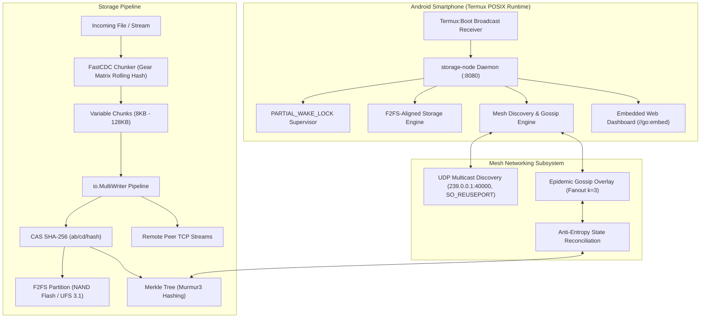

# Android Distributed Storage System (MobileDFS)

[](https://golang.org)
[](https://termux.dev)
[](https://github.com/android-dfs)
[](https://en.wikipedia.org/wiki/F2FS)

A resilient, decentralized peer-to-peer storage engine and distributed file system engineered to turn a fleet of consumer Android smartphones into an autonomous, fault-tolerant storage cluster. Executed inside the **Termux** Linux environment using statically compiled Go binaries, the system leverages **UDP Multicast** and **Gossip (Epidemic Routing)** for decentralized discovery, **FastCDC (Content-Defined Chunking)** with Level-2 Normalization for deduplication, **SHA-256 Content-Addressable Storage (CAS)**, and **Merkle Trees** with **Murmur3** for anti-entropy state synchronization across volatile mobile networks.

---

## Table of Contents
1. [System Architecture](#system-architecture)
2. [Android Execution Environment & OS Resilience](#android-execution-environment--os-resilience)
   - [Termux POSIX Environment & Path Conventions](#termux-posix-environment--path-conventions)
   - [The Phantom Process Killer (AOSP Android 12–15)](#the-phantom-process-killer-aosp-android-1215)
   - [OS Mitigations Matrix & Partial WakeLocks](#os-mitigations-matrix--partial-wakelocks)
3. [Peer Discovery & Mesh Networking](#peer-discovery--mesh-networking)
   - [UDP Multicast & Socket Options (SO_REUSEADDR & SO_REUSEPORT)](#udp-multicast--socket-options)
   - [Gossip Protocol Overlay (Epidemic Routing)](#gossip-protocol-overlay-epidemic-routing)
4. [Storage Engine Architecture](#storage-engine-architecture)
   - [NAND Flash Dynamics: F2FS vs. EXT4](#nand-flash-dynamics-f2fs-vs-ext4)
   - [Content-Defined Chunking (FastCDC with Level-2 Normalization)](#content-defined-chunking-fastcdc)
   - [Content-Addressable Storage (CAS) & Directory Sharding](#content-addressable-storage-cas--directory-sharding)
   - [Zero-Buffer Stream Replication (`io.MultiWriter`)](#zero-buffer-stream-replication-iomultiwriter)
   - [Anti-Entropy & State Reconciliation via Merkle Trees](#anti-entropy--state-reconciliation-via-merkle-trees)
5. [Embedded Management Interface (Go 1.16+)](#embedded-management-interface-go-116)
   - [Virtual Filesystem (`//go:embed` & `fs.Sub`)](#virtual-filesystem)
   - [SPA Client-Side Routing Fallback Handler](#spa-client-side-routing-fallback-handler)
   - [Cluster Dashboard & Telemetry](#cluster-dashboard--telemetry)
6. [Directory Structure](#directory-structure)
7. [Deployment & Quick Start](#deployment--quick-start)

---

## System Architecture



---

## Android Execution Environment & OS Resilience

Operating continuous storage daemons on consumer Android devices requires overcoming hostile OS heuristics designed to aggressively terminate background processes to conserve battery life.

### Termux POSIX Environment & Path Conventions
Unlike traditional GNU/Linux environments where core utilities reside in `/bin` or `/usr/bin`, Termux maintains an application-specific userland root prefix:
```bash
/data/data/com.termux/files/usr/bin
```
All system scripts and daemon launchers must declare explicit Termux paths:
```bash
#!/data/data/com.termux/files/usr/bin/bash
```
Unattended startup on device boot is implemented via the **Termux:Boot** add-on, which registers the system broadcast `android.intent.action.BOOT_COMPLETED` and executes:
```bash
~/.termux/boot/boot_storage_node.sh
```

### The Phantom Process Killer (AOSP Android 12–15)
Introduced in Android 12 via AOSP commit `15755084` and updated in `5706277f`:
- Enforces an operating-system-wide limit of **exactly 32 phantom/child processes** across all running applications.
- When background child processes exceed CPU thresholds or the 32-process limit is breached, Android's `ActivityManager` issues a `SIGKILL (signal 9)`.
- Because the Go runtime scheduler (`G-M-P` model) dynamically spawns OS-level threads (`M`) to service blocking I/O calls and cryptographic hashing, unmitigated nodes are abruptly killed.

### OS Mitigations Matrix & Partial WakeLocks

| Android Version | Phantom Process Killer Override Strategy | Persistence & Requirements |
| :--- | :--- | :--- |
| **Android 11 & Earlier** | No action required. Process killer does not exist in AOSP. | Permanent out-of-the-box operation. |
| **Android 12 & 13** | Run via ADB: <br>`device_config put activity_manager max_phantom_processes 2147483647`<br>`device_config set_sync_disabled_for_tests persistent` | Survives reboots; can be reset by Google Play Services updates. Requires PC/ADB. |
| **Android 14 & 15** | System Developer Options: Toggle **"Disable child process restrictions"** ON. | **Permanent local setting**. Does not require a PC or ADB connection. |
| **Rooted (Magisk/KernelSU)**| Write `-1000` to `/proc/$PID/oom_score_adj`. | Absolute immunity against both Phantom Killer and Low Memory Killer (LMK). |

#### Partial WakeLocks
To prevent the Linux kernel from entering deep CPU sleep when the display locks, the daemon acquires a `PowerManager.PARTIAL_WAKE_LOCK` via `termux-wake-lock`:
```bash
termux-wake-lock
```
Verification via ADB/dumpsys:
```bash
dumpsys power | grep -i "PARTIAL_WAKE_LOCK"
```

---

## Peer Discovery & Mesh Networking

### UDP Multicast & Socket Options
Localized discovery operates on IPv4 multicast group `239.0.0.1:40000` using IGMP. To allow multiple storage node instances or worker processes to bind on the same Android device simultaneously without port conflicts, Go's `net.ListenConfig` applies low-level socket options:

```go
// Linux / Android Socket Configuration
func SocketControl(network, address string, c syscall.RawConn) error {
    return c.Control(func(fd uintptr) {
        // SO_REUSEADDR: Allows immediate binding after daemon restart
        syscall.SetsockoptInt(int(fd), syscall.SOL_SOCKET, syscall.SO_REUSEADDR, 1)
        // SO_REUSEPORT: Kernel distributes datagrams evenly across CPU cores
        syscall.SetsockoptInt(int(fd), syscall.SOL_SOCKET, 15, 1)
    })
}
```

### Gossip Protocol Overlay (Epidemic Routing)
For wide-area synchronization and routing across volatile Wi-Fi/cellular meshes:
- Nodes periodically select $k = 3$ random peers every 2 seconds.
- Nodes exchange routing tables, Merkle root hashes, and available capacity.
- State disseminates logarithmically $\mathcal{O}(\log N)$, providing resilience against mobile churn (device movement, battery depletion).

---

## Storage Engine Architecture

### NAND Flash Dynamics: F2FS vs. EXT4
Mobile flash storage uses a **Flash Translation Layer (FTL)**:
- **EXT4 Limitations**: In-place overwrites cause high **Write Amplification (WA > 3.5x)**, forcing the FTL to repeatedly erase 2MB–4MB flash blocks for small random writes.
- **F2FS Log-Structuring**: Coalesces random writes into large sequential log segments, matching 4KB NAND pages and 2MB erase blocks. Write amplification drops to $\approx 1.05\times$, preserving flash cell lifespan.
- Full compatibility with Android File-Based Encryption (`fscrypt`).

### Content-Defined Chunking (FastCDC)
To prevent the "boundary shift" vulnerability of fixed-size chunking, FastCDC determines chunk boundaries dynamically:
- Uses a 256-element 64-bit **Gear matrix** rolling hash.
- Skips the first `MinSize` (8 KB) bytes without hashing to accelerate throughput (> 1 GB/s).
- **Level-2 Normalization**: Employs two masks (`maskS` and `maskL`) around the `AvgSize` (32 KB) boundary, creating a tight chunk size distribution with low metadata overhead.

### Content-Addressable Storage (CAS) & Directory Sharding
- Every chunk is identified by its cryptographic **SHA-256** hash.
- Storage directories use 2-level hexadecimal nesting:
  ```text
  storage_data/chunks/3a/7f/3a7f9b8c0d1e2f...
  ```
  This prevents inode/dentry degradation on Android filesystems.

### Zero-Buffer Stream Replication (`io.MultiWriter`)
When files are ingested, data streams directly through `io.MultiWriter` to local disk and network peer connections concurrently:
```go
multiWriter := io.MultiWriter(localFile, sha256Hasher, peerSocketConn)
io.CopyBuffer(multiWriter, requestBody, pageAlignedBuffer)
```
Multi-megabyte payloads are never loaded completely into RAM, protecting the daemon from Android Out-Of-Memory (OOM) killer terminations.

### Anti-Entropy & State Reconciliation via Merkle Trees
- CAS chunk hashes form the leaves of a hierarchical **Merkle Tree**.
- Intermediate nodes are hashed using **Murmur3-64** for fast computation.
- Nodes exchange root hashes during Gossip rounds:
  - If root hashes match: Zero network payload transferred.
  - If root hashes differ: Nodes traverse the tree using cursor iteration (`First()` / `Next()`) to isolate the exact missing chunks, transferring only the necessary delta.

---

## Embedded Management Interface (Go 1.16+)

### Virtual Filesystem
The web dashboard is baked directly into the Go binary at compile time:
```go
//go:embed all:dist
var DistFS embed.FS
```
`fs.Sub(DistFS, "dist")` strips the directory prefix, allowing assets to resolve directly from root `/`.

### SPA Client-Side Routing Fallback Handler
To support client-side routing in single-page applications without returning 404s on page refresh, a custom `SPAFileSystem` catches `os.ErrNotExist` and falls back to serving `index.html` with an `HTTP 200 OK` status.

### Cluster Dashboard & Telemetry
The embedded dashboard provides:
- **Cluster Telemetry**: Node count, CAS stored bytes, deduplication ratio, F2FS write amplification, and Merkle root fingerprint.
- **Host Diagnostics**: Android OS version, Termux POSIX layer status, Partial WakeLock state, and filesystem type.
- **Node Mesh Grid**: Live list of mobile nodes, IP addresses, chunk counts, and manual anti-entropy sync triggers.
- **FastCDC Live Ingestion**: Real-time chunking inspector with chunk offsets, sizes, SHA-256 hashes, and deduplication hit badges.
- **Live Event Log**: WebSocket-driven telemetry feed of peer discovery, Gossip rounds, and CAS storage events.

---

## Directory Structure

```text
.
├── cmd/
│   └── storage-node/
│       └── main.go                  # Main entry point: flags, signals, boot orchestration, API & P2P launch
├── pkg/
│   ├── api/
│   │   ├── server.go                # REST API router (status, nodes, upload, chunks, gossip)
│   │   └── websocket.go             # RFC 6455 WebSocket hub & Server-Sent Events (SSE) dispatcher
│   ├── config/
│   │   └── config.go                # System configuration, paths, FastCDC parameters, F2FS segment tuning
│   ├── discovery/
│   │   ├── multicast.go             # UDP Multicast peer discovery engine (239.0.0.1:40000)
│   │   ├── socket_linux.go          # SO_REUSEADDR & SO_REUSEPORT socket control for Linux/Android
│   │   └── socket_other.go          # Cross-platform socket control fallback for Windows/macOS
│   ├── entropy/
│   │   ├── merkle.go                # Hierarchical Merkle Tree data structure & cursor traversal
│   │   ├── murmur3.go               # Fast Murmur3 non-cryptographic hash (32-bit & 64-bit)
│   │   └── reconciliation.go        # Range diff calculation and delta isolation
│   ├── gossip/
│   │   ├── node.go                  # Peer metadata descriptors & cluster state transition events
│   │   ├── protocol.go              # Epidemic routing engine, random fanout, and anti-entropy triggers
│   │   └── state.go                 # Thread-safe routing table & mobile churn management
│   ├── resilience/
│   │   ├── android.go               # Android OS detection, Termux pathing, Phantom Process Killer audit
│   │   └── wakelock.go              # Termux Partial WakeLock supervisor & dumpsys power verifier
│   ├── storage/
│   │   ├── cas.go                   # Content-Addressable Storage (SHA-256, 2-level directory sharding)
│   │   ├── f2fs.go                  # Flash-Friendly File System (F2FS) log-structured write optimizer
│   │   ├── fastcdc.go               # FastCDC rolling hash chunker (Gear matrix, Level-2 Normalization)
│   │   └── multiwriter.go           # Zero-buffer io.MultiWriter stream replication
│   └── ui/
│       ├── dist/
│       │   ├── index.html           # Embedded MobileDFS dashboard
│       │   └── favicon.ico
│       └── spa_handler.go           # Go 1.16+ embed.FS handler with client-side SPA routing fallback
├── scripts/
│   ├── build.sh                     # Cross-compilation script (Android ARM64/ARMv7, Linux AMD64, Windows)
│   ├── run_cluster_demo.ps1         # PowerShell 3-node simulation cluster launcher
│   └── termux/
│       ├── boot_storage_node.sh     # Auto-start script for ~/.termux/boot/ with wake lock acquisition
│       ├── disable_phantom_killer.sh# ADB and Android 12-15 Phantom Process Killer overrides
│       └── setup_termux.sh          # One-click bootstrap script for Termux devices
├── go.mod                           # Go 1.21 module
└── README.md                        # Master architectural manual and deployment guide
```

---

## Deployment & Quick Start

### 1. Running Locally (Simulation Mode)
```bash
# Build the storage node binary
go build -o bin/storage-node ./cmd/storage-node

# Start Node 1 (Host Node on :8080)
./bin/storage-node -http=":8080" -name="Host-Alpha" -data-dir="./data/node1"

# In a separate terminal, start Node 2 (Edge Peer on :8081)
./bin/storage-node -http=":8081" -name="Edge-Bravo" -data-dir="./data/node2"
```
Open **`http://localhost:8080/`** to view the cluster dashboard.

### 2. Deploying to Android via Termux

#### Prerequisites:
1. Install **Termux** and **Termux:Boot** from [F-Droid](https://f-droid.org/en/packages/com.termux/).
2. On Android 12/13, run the ADB phantom killer bypass script from your PC:
   ```bash
   bash scripts/termux/disable_phantom_killer.sh
   ```
   *(On Android 14/15, enable "Disable child process restrictions" in Developer Options).*

#### Installation inside Termux:
```bash
# Update packages and install dependencies
pkg update && pkg install -y git golang termux-api

# Clone this repository
git clone https://github.com/android-dfs/storage-node.git ~/distributed-storage
cd ~/distributed-storage

# Run setup script (installs boot script to ~/.termux/boot/ and acquires wakelock)
bash scripts/termux/setup_termux.sh

# Compile static Android binary
go build -o ~/storage-node ./cmd/storage-node

# Launch storage daemon
~/storage-node -android=true -wakelock=true -http=":8080"
```

The storage daemon runs as a persistent Android background service. Open `http://<phone-ip>:8080/` on any device on the local Wi-Fi network to access the MobileDFS management dashboard.
